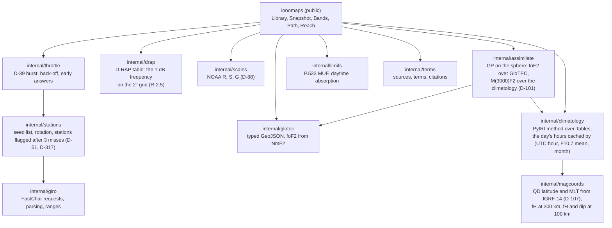

# Design

The public shape is the package's own documentation (`go doc github.com/branden-thompson/go-ionomaps`) and
its review, [`api-review.md`](api-review.md); watchpost's architecture says only what watchpost relies on, by
role ("go-ionomaps, as watchpost uses it", watchpost D-F4). The update's timing and GIRO's burst - the time budget, what each
ask's end is evidence of, a burst's order, how a burst ends - are one model of their own:
[`update-timing-model.md`](update-timing-model.md) (watchpost D-312). This page holds the library's inside: its packages, its update, and **where every algorithm comes
from** (watchpost D-53).

## Packages



## One update

1. **Throttle** (R-5.3, R-5.4): within the hour's budget? If not, answer from the last good snapshot, with its age and the reason; when the host's options have changed, that snapshot is rebuilt at its own time from what is held, nothing asked (A-7).
2. **Stations** (R-5.5): the seed list in rotation, a station that misses three asks in a row flagged and asked every 6 hours, never more than 40 requests together (D-87).
3. **Fetch**, through the host's fetcher (R-5.1), in two updates when GIRO is due (D-63): the first asks NOAA and returns its snapshot, said StationsNext; the host's next, at once, makes GIRO's burst (`internal/giro`'s Asker, over `internal/throttle` and `internal/stations`):
   - GIRO readings since the last held (R-5.2), foF2 and M(3000)F2 alone (D-62);
   - GloTEC's newest grid, found by its timestamped name or the directory index (W0.0 measures which; a new grid is never a 304, D-111);
   - D-RAP;
   - NOAA's space-weather scales (D-88);
   - NOAA's daily solar indices, at most once a day (watchpost D-104).

   A 429 stops the update and starts the back-off.
4. **Parse and check** (R-3.3, R-3.4): header lines dropped; every value range-checked; rejects counted.
5. **Background:**
   - foF2: GloTEC's, from NmF2 (else the climatology's, named);
   - M(3000)F2: the climatology's (watchpost D-101);
   - else the climatology (named, FR-5.2).
6. **Assimilate** (R-9.2): station residuals for foF2 (over GloTEC) and M(3000)F2 (over the climatology), a GP on the sphere each, added to its background. **The offset** (R-9.6, D-105): with five or more readings over GloTEC, the live offset is their mean residual, and the typical offset (seeded at -0.5 MHz) learns from it once per burst's readings; with none assimilated and the host asking (`UpdateOptions.CorrectNoReadings`), GloTEC's foF2 is moved by the typical offset, and the snapshot says so.
7. **Hours ahead** (R-1.3, watchpost D-109): each hour ahead is the climatology's hour from the day's cache, marked typical, with the typical error and its basis: a snapshot of its own (`Snapshot.Ahead`), carrying no D-RAP disturbance and no live offset (watchpost D-216).
8. **Snapshot:** fields, computed time, the inputs' own times (GloTEC's valid time, the oldest reading, D-RAP's), backgrounds per field, the offset, D-RAP's 1 dB frequency a cell and its valid time (a band open under its upper limit with its lower edge under it is disturbed, R-2.5), the noise environment asked for (D-187), sources. The answers judge each band under its upper limit by the reference circuit's lower limit (R-2.4, D-70): absorbed or weak, at the LUF; the typical day's open hours keep both limits. NOAA comes first, so a first snapshot without stations precedes the GIRO burst (watchpost architecture, "Opening the mode").

Every point answer carries its nearest station, how far and whether unscored: a place's from its cell, a path's from its control point furthest from any (R-2.11, D-65). The answers (`Readings`, `Bands`, `Path`, `Reach`) are pure functions of a snapshot (R-2), each for the snapshot's own hour and its sun, so a host can call them off
its UI goroutine without touching the network. The public API as reviewed for a host developer before v0.1.0's release candidate is in [api-review.md](api-review.md) (watchpost D-216).

## Provenance (watchpost D-53)

`arodland/prop` is never opened. Each component's source is below, and each exported function cites its
source in its doc comment (R-7.1).

| Component | Method | Source |
|---|---|---|
| foF2 from NmF2 | f = 8.98×10⁻⁶ √N (plasma frequency) | standard ionospheric physics; ITU-R P.1239 |
| Climatology | spherical-harmonic and Fourier evaluation of foF2 and M(3000)F2 for a month, solar level and hour | **PyIRI (MIT, ported)**, `sh_library.py`; Forsythe et al. 2024 (doi:10.1029/2023SW003739); the NRL refits (D-43) |
| Magnetic coordinates | IGRF-14 field, field lines traced to the apex; quasi-dipole latitude from the apex height; MLT from the subsolar point's quasi-dipole longitude; generated at build time | IAGA IGRF-14 (its release paper, cited in BUILD); Richmond 1995 (J. Geomag. Geoelectr. 47, 191-212); Laundal & Richmond 2017 (Space Sci. Rev.); checked against PyIRI's `Apex.nc` (MIT) (watchpost D-107) |
| Assimilation | Gaussian-process regression of station residuals; exponential kernel in great-circle distance | Rasmussen & Williams 2006; Gneiting 2013 (doi:10.3150/12-BEJSP06); validated against Galkin et al. 2012 (IRTAM, doi:10.1029/2011RS004952) |
| Hours ahead | the climatology for each hour, marked typical; its error measured on PLAN's week | watchpost D-109; `02-analysis/evidence/week.py` |
| MUF for a path | basic MUF from foF2, M(3000)F2 and distance | ITU-R P.533-14 §3.4-3.5, equations checked against the recommendation's worked values (R-2.7) |
| The lower limit (G6.2b, G6.2c) | the reference circuit's median S/N by P.533-14 §5.2 to §7: past 7000 km §5.3's composite field (fM with K, eq. (33)'s LUF through the day with the winter anomaly and the night decay, eq. (39)), blended with §5.2 from 7000 to 9000 km (eq. 42); the auroral loss Lh (Table 2); to 9000 km §5.2: three E and six F2 modes (§5.2.1), E-layer screening (§4), elevation and the F2 mirror height (§5.1), slant range, Lm, Lg, Lz, the modes summed in power; P.372-18's man-made noise for the host's environment plus galactic above foF2; R12 from F10.7 by P.371-9; Absorbed where absorption decides, Weak where the circuit cannot reach +13 dB even without it (D-70), at the LUF | ITU-R P.533-14, P.372-18, P.371-9, each equation read from the recommendation (`02-analysis/evidence/p533-field-strength.md`) |
| Daytime absorption | P.533-14 eq. (20): ATnoon by latitude and month, the penetration factor phi by fv/foE, the diurnal exponent p by modified dip and month, F(chi) = cos^p(0.881 chi), Li over (f + fL)^2; the dip and gyrofrequency at 100 km from IGRF-14; for the reference circuit (D-186 to D-189) | ITU-R P.533-14 §5.2.2; **the three factors (and later Tables 2 and 5) ported from ITU-R SG3's ITUHFProp**, "free from any copyright assertions" for implementers (D-186, D-189), held to ITUHFProp's own values (A-10) |
| Disturbance | D-RAP's 1 dB frequency; below it, "disturbed" | NOAA SWPC D-RAP (public domain) |
| Space-weather scales | NOAA's R, S and G levels and outlook, carried as published; named, not modelled (D-88) | NOAA SWPC scales feed (public domain) |
| Reach | the area where a frequency lies between the limits along paths from an origin; the skip zone where the sky wave first returns | geometry over the path model above |

## Tables (the seam, D-43)

```go
type Tables interface {
    FoF2(month int, solar Level) Coefficients
    M3000(month int, solar Level) Coefficients
}
```

The shipped implementation reads NRL's refits, converted at build time into a compact Go-readable form. A
test runs the climatology on supplied tables (R-4.4), so the refits can be replaced.

## What the dry run decides here

- the kernel length and noise: measured on PLAN's week, foF2 over GloTEC L = 2000 km, noise 0.5; M(3000)F2 over the climatology L = 2000 km, noise 0.2 (relative to the residuals' variance; `week.py`), with the values' basis carried as constants (A-29);
- the hours ahead's typical error (watchpost D-109);
- the near-vertical radius: the host's to give (watchpost D-100: 400 km by default, a Setting);
- the F10.7 rule;
- the refits' accuracy against PyIRI's raw CCIR tables.

Each is recorded in watchpost's `07-readiness/dry-run.md` and ruled where it sets a target (watchpost D-49).
